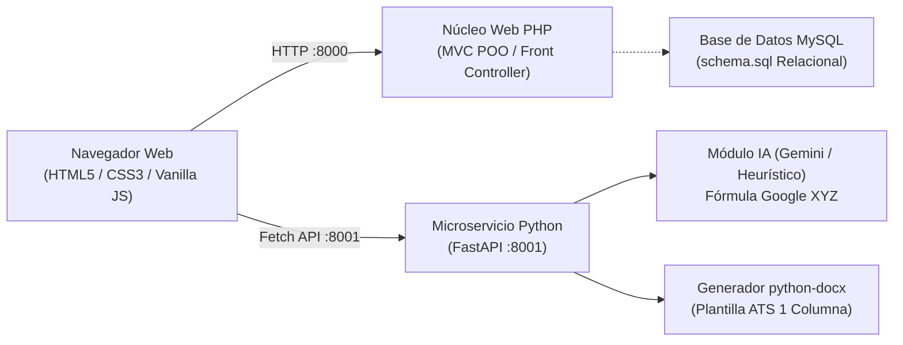

# 🚀 CvGenerate &mdash; Generador de Currículums ATS con Inteligencia Artificial

> **Sistema de Generación de Currículums de Clase Mundial** optimizado estrictamente para superar los filtros de reclutamiento automatizado (**ATS: Applicant Tracking Systems**) y captar la atención de reclutadores senior en menos de 6 segundos.

---

## 📌 Tabla de Contenidos
- [Características Principales](#-características-principales)
- [Arquitectura del Sistema](#-arquitectura-del-sistema)
- [Estructura del Proyecto](#-estructura-del-proyecto)
- [Plantilla Maestra ATS (Estándar 1 Columna)](#-plantilla-maestra-ats-estándar-1-columna)
- [Módulo de IA: Adaptador a Ofertas Laborales](#-módulo-de-ia-adaptador-a-ofertas-laborales)
- [Requisitos del Sistema](#-requisitos-del-sistema)
- [Instalación y Puesta en Marcha](#-instalación-y-puesta-en-marcha)
- [Documentación de la API](#-documentación-de-la-api)
- [Reglas de Oro del Reclutamiento Senior](#-reglas-de-oro-del-reclutamiento-senior)
- [Próximos Pasos (Roadmap)](#-próximos-pasos-roadmap)

---

## ✨ Características Principales

* **Plantilla Maestra ATS Estricta:** Generación de documentos en formato de **una sola columna**, alineación a la izquierda, tipografía estándar de alta legibilidad (Calibri/Arial) y **viñetas sólidas nativas (`•`)**, sin cuadros de texto flotantes ni tablas anidadas que rompen el algoritmo de lectura de plataformas como *Workday, Lever, Greenhouse o Taleo*.
* **Motor de IA "Job Description Tailorer":**
  * Extrae requerimientos, competencias técnicas y metodologías clave desde el texto de una oferta laboral.
  * Audita la compatibilidad del candidato calculando el **Puntaje de Coincidencia (Match ATS %)**.
  * Reescribe el **Resumen Profesional** como un *Elevator Pitch* de alto impacto libre de clichés.
  * Reformula los logros de experiencia laboral aplicando la **Fórmula XYZ de Google**: *"Logré [X], medido por [Y], haciendo [Z]"*, incorporando métricas cuantificables (%, latencia, tiempos, volúmenes de usuarios).
* **Guía de Clase Mundial en Pantalla:** Recomendaciones y tips estratégicos incorporados en el Dashboard y mediante un acordeón interactivo en el editor antes de empezar.
* **Carga de Perfil de Prueba en 1 Clic:** Botón para autocompletar el formulario al instante con un perfil real de Senior Full-Stack Engineer.
* **Simulador de Hoja A4 / Previsualización:** Renderizado visual en tiempo real de cómo se verá el documento impreso antes de descargarlo.
* **Generación Directa a Word (.docx):** Descarga instantánea de archivos compatibles con Microsoft Word mediante `python-docx`.

---

## 🏗️ Arquitectura del Sistema

El proyecto implementa una arquitectura desacoplada de alto rendimiento:



1. **Frontend & Core Web (PHP Nativo POO):**
   * Patrón **MVC (Model-View-Controller)** desarrollado desde cero con **Front Controller** (`public/index.php`) y un **Router POO** extensible con compilación regex de parámetros dinámicos (`/cv/{id}`).
   * Diseñado con estándares limpios (PSR-4) para facilitar una migración directa y fluida a **Laravel**.
2. **Microservicio Generador e IA (Python / FastAPI):**
   * API RESTful de baja latencia con validación de tipos mediante **Pydantic**.
   * Generador de documentos `.docx` con `python-docx` y motor de optimización asistida por IA.

---

## 📂 Estructura del Proyecto

```text
CvGenerate/
├── start.sh                        # Script de inicio unificado para macOS (levanta PHP y Python)
├── .gitignore                      # Exclusiones de Git (venvs, temp docs, logs)
├── README.md                       # Documentación integral del proyecto
├── database/
│   └── schema.sql                  # Script relacional DDL MySQL con datos semilla
├── backend-php/
│   ├── config/
│   │   ├── database.php            # Configuración de conexión PDO MySQL
│   │   └── microservice.php        # Configuración de URLs del microservicio Python
│   ├── public/
│   │   ├── .htaccess               # Reescritura Apache hacia index.php
│   │   ├── index.php               # Front Controller principal y Autoloader PSR-4
│   │   ├── css/
│   │   │   └── style.css           # Estilos modernos, diseño responsive y simulación A4
│   │   └── js/
│   │       └── app.js              # Lógica de cliente, DOM dinámico, Fetch API y conexión con IA
│   ├── routes/
│   │   └── web.php                 # Registro declarativo de rutas
│   ├── src/
│   │   ├── Core/
│   │   │   ├── Router.php          # Enrutador HTTP POO (GET, POST, PUT, DELETE, regex)
│   │   │   ├── Controller.php      # Controlador base con renderizado de vistas y respuestas JSON
│   │   │   ├── Request.php         # Abstracción de parámetros HTTP y cuerpos JSON
│   │   │   └── Database.php        # Gestor de conexión PDO (Singleton)
│   │   └── Controllers/
│   │       ├── HomeController.php  # Controlador para Home, Dashboard y Health Check
│   │       └── CvController.php    # CRUD de CVs, validación y puente API
│   └── views/
│       ├── layouts/
│       │   └── main.php            # Layout base HTML5
│       ├── home/
│       │   └── index.php           # Dashboard con Guía de Clase Mundial
│       └── cv/
│           ├── form.php            # Editor dinámico con tips y panel de IA
│           └── preview.php         # Previsualización de hoja A4 estándar ATS
└── microservice-python/
    ├── app/
    │   ├── __init__.py
    │   ├── main.py                 # FastAPI endpoints (/health, /api/generate-docx, /api/tailor-cv)
    │   ├── schemas/
    │   │   └── cv_schema.py        # Modelos Pydantic de validación
    │   └── services/
    │       ├── docx_builder.py     # Generador DOCX con formato estricto ATS (1 columna)
    │       └── ai_tailorer.py      # Motor de IA: extracción de keywords, Match ATS y Fórmula XYZ
    ├── generated_docs/             # Almacenamiento temporal de documentos .docx
    ├── requirements.txt            # Dependencias Python (fastapi, uvicorn, python-docx, pydantic)
    └── .env.example
```

---

## 📄 Plantilla Maestra ATS (Estándar 1 Columna)

El microservicio renderiza estrictamente las siguientes secciones en este orden exacto:

1. **Encabezado:** Nombre completo en 19pt bold, cargo objetivo, datos esenciales (Ciudad, País, Teléfono, Email) y enlaces profesionales (*LinkedIn obligatorio; GitHub y Portafolio opcionales*). **Sin foto, edad ni estado civil.**
2. **Resumen Profesional (Elevator Pitch):** 3 a 4 líneas de alto impacto que explican la especialidad y el valor inmediato que aporta a la empresa, sin frases genéricas.
3. **Competencias Técnicas:** Clasificación limpia por categorías (*Lenguajes, Frameworks, Bases de Datos, Cloud & DevOps*) adaptadas a las palabras clave de la oferta.
4. **Experiencia Profesional:** Orden cronológico inverso, detallando *Cargo | Fechas (Mes/Año) | Empresa • Ubicación*, acompañado de viñetas sólidas con logros cuantificables bajo la **Fórmula XYZ**.
5. **Proyectos Destacados:** Nombre, tecnologías utilizadas, enlace de repositorio/demo y descripción del impacto técnico.
6. **Educación y Certificaciones:** Título académico, institución universitaria y año de egreso.

---

## 🤖 Módulo de IA: Adaptador a Ofertas Laborales

Al pegar la descripción de una vacante en el editor, el motor de IA ejecuta el siguiente flujo:

1. **Extracción Semántica:** Detecta tecnologías críticas, certificaciones y verbos clave del puesto.
2. **Auditoría de Brecha (Gap Analysis):** Compara el CV actual con la vacante y entrega un puntaje de compatibilidad (ej. *45% &rarr; 92%*), listando las palabras clave faltantes.
3. **Optimización Google XYZ:** Audita cada viñeta de experiencia laboral y la redacta como:
   $$\text{"Logré [X], medido por [Y], haciendo [Z]"}$$
   *Ejemplo real generado:*
   > *"Optimizé la arquitectura de microservicios en Python y PHP, reduciendo la latencia de respuesta en un 38% para más de 500k usuarios activos mensuales."*
4. **Modo Híbrido:** Admite integración con la API de **Google Gemini** y cuenta con un **optimizador heurístico local automático** que funciona de inmediato sin necesidad de claves externas.

---

## ⚙️ Requisitos del Sistema

* **macOS**, Linux o Windows (WSL2 recomendado para Windows).
* **PHP 8.2 o superior** (verificado en PHP 8.5+).
* **Python 3.11 o superior** (verificado en Python 3.14).
* Navegador moderno (Chrome, Safari, Firefox, Edge).

---

## 🚀 Instalación y Puesta en Marcha

### 1. Clonar el Repositorio
```bash
git clone https://github.com/kmoraga2003/CvGenerate.git
cd CvGenerate
```

### 2. Entorno Virtual de Python (Microservicio)
Si es la primera vez que clonas el proyecto, crea el entorno virtual e instala las dependencias:
```bash
python3 -m venv microservice-python/venv
source microservice-python/venv/bin/activate
pip install -r microservice-python/requirements.txt
```

### 3. Arranque Automático en 1 Paso (macOS / Linux)
Ejecuta el script unificado que libera puertos y arranca ambos servidores coordinadamente:
```bash
./start.sh
```

El script iniciará:
* 🐍 **Microservicio Python (FastAPI & IA):** `http://127.0.0.1:8001`
* 🌐 **Frontend Web (PHP MVC):** `http://127.0.0.1:8000`

---

### Arranque Manual (Opcional)

Si prefieres ejecutar cada servicio en terminales independientes:

* **Terminal 1 (Microservicio Python):**
  ```bash
  source microservice-python/venv/bin/activate
  PYTHONPATH=microservice-python python -m uvicorn app.main:app --host 127.0.0.1 --port 8001 --app-dir microservice-python
  ```

* **Terminal 2 (Frontend PHP):**
  ```bash
  php -S 127.0.0.1:8000 -t backend-php/public
  ```

---

## 🌐 Documentación de la API

### Endpoints del Microservicio Python (`:8001`)

| Método | Endpoint | Descripción | Payload |
| :--- | :--- | :--- | :--- |
| `GET` | `/health` | Verificación de estado del microservicio | &mdash; |
| `POST` | `/api/generate-docx` | Genera y descarga el archivo `.docx` con formato ATS | `CvDataSchema` (JSON) |
| `POST` | `/api/tailor-cv` | Audita contra una oferta y devuelve el CV optimizado | `TailorRequestSchema` (CV + Job Text) |
| `POST` | `/api/tailor-and-generate-docx` | Adapta con IA y descarga directamente el `.docx` | `TailorRequestSchema` |

### Rutas del Núcleo Web PHP (`:8000`)

| Método | Ruta | Vista / Acción |
| :--- | :--- | :--- |
| `GET` | `/` | Dashboard principal y Guía de Clase Mundial |
| `GET` | `/cv/nuevo` | Formulario y editor dinámico con panel de IA |
| `GET` | `/cv/preview` | Vista previa de hoja A4 estándar ATS |
| `POST` | `/api/cv/save` | Validación y estructuración de secciones del CV |
| `GET` | `/api/health` | Health Check en formato JSON |

---

## 🏆 Reglas de Oro del Reclutamiento Senior

1. **La Regla de la Página:** 1 sola página para profesionales con menos de 10 años de experiencia; 2 páginas máximo para perfiles directivos o muy experimentados.
2. **Verbos de Acción Fuerte:** Reemplaza frases pasivas (*"apoyé en...", "responsable de..."*) por verbos ejecutivos: *Diseñé, Dirigí, Optimizé, Automaticé, Desplegué*.
3. **Cuantificación Rigurosa:** Las métricas construyen credibilidad. Añade números a cada logro: porcentajes de optimización, volumen de datos o dinero ahorrado.
4. **Cero Elementos Incompatibles:** Nunca uses tablas anidadas, cuadros de texto flotantes, barras de progreso gráficas o fotografías (a menos que el mercado local lo exija).
5. **Tailoring Dinámico:** El currículum debe ser un documento base vivo que se adapta a las palabras clave exactas de cada postulación.

---

## 🗺️ Próximos Pasos (Roadmap)

- [x] Arquitectura base MVC en PHP nativo y microservicio FastAPI en Python.
- [x] Esquema relacional DDL MySQL (`schema.sql`) para todas las secciones ATS.
- [x] Generador de documentos `.docx` con `python-docx` y viñetas sólidas nativas.
- [x] Motor de IA para cálculo de Match ATS y adaptación mediante la Fórmula Google XYZ.
- [x] Panel interactivo en frontend con carga de perfiles de prueba y vista previa A4.
- [ ] **Migración a Laravel:** Adopción de Eloquent ORM, Blade components y base de datos local SQLite con 0 configuración.
- [ ] **Conversión Directa a PDF:** Integración de exportación a PDF de alta fidelidad manteniendo la estructura ATS.
- [ ] **Historial de Postulaciones:** Almacenamiento de múltiples versiones de CVs adaptados según la empresa y el cargo.

---

## 👨‍💻 Autor y Licencia
Desarrollado como solución integral de ingeniería de software para candidatos técnicos y profesionales de alto impacto. Distribuido bajo licencia MIT.
